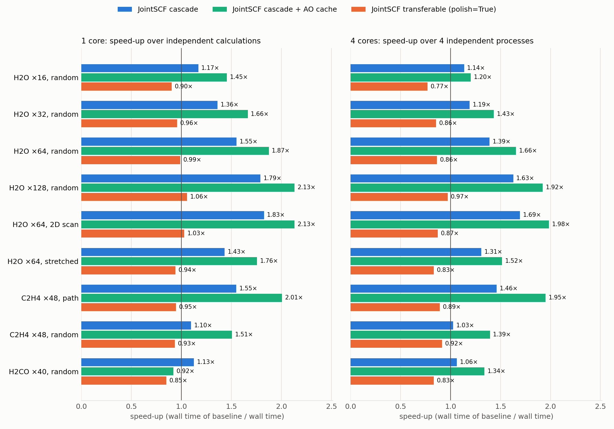
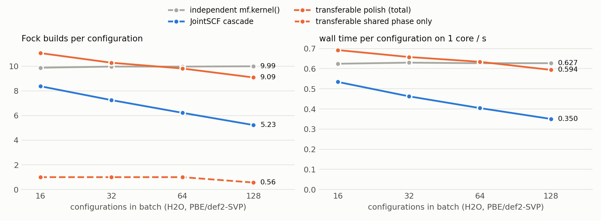
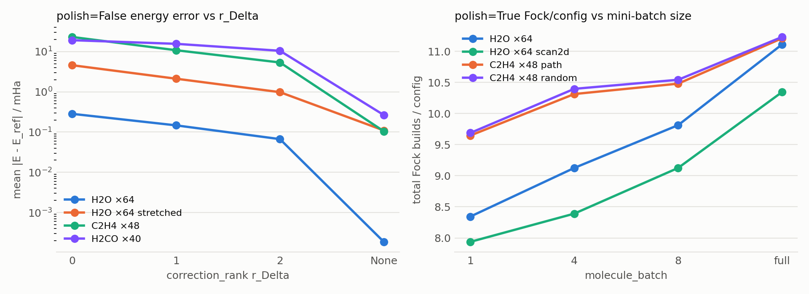

# JointSCF：多构型单循环求解、可迁移联合优化与基准评估

本报告对应仓库分支 `claude/nifty-hypatia-82wvns`（PR #11）上的实现，覆盖 `sync`、`cascade` 与新增的 `transferable` 三种调度：

| 文件 | 内容 |
|---|---|
| `pyscf/scf/jointscf.py`（新增） | `JointSCF` 驱动、跨构型核岭回归模型 `SharedModel`、`sync`/`cascade`/`transferable` 调度、线程/进程后端 |
| `pyscf/scf/_transferable.py`（新增） | 可迁移联合优化内部模块：Kabsch/正则坐标对齐、`GeometryConditionedSubspace`、正对角 thin-QR 与反向 VJP、单 Fock 精确梯度、`TransferableGroupModel`、半正则轨道与二阶误差估计 |
| `pyscf/dft/numint.py`（修改） | 新增 `CachedNumInt`：在内存中缓存格点 AO 值 |
| `pyscf/scf/__init__.py`（修改） | 导出 `scf.JointSCF`、`scf.jointscf` |
| `pyscf/scf/test/test_jointscf.py`、`pyscf/dft/test/test_cached_numint.py`（新增） | 共 25 个单元测试（含 6 个 `transferable` 专项测试） |
| `examples/scf/57-joint_scf.py`（新增） | 用法示例 |
| `benchmark/jointscf/`（新增） | 9 个构型系综、`run_benchmark.py`、`run_ablation.py`、`count_fock.py`、`analyze.py`、原始数据 `results.json`/`ablation_results.json`、本报告 |

---

## 结论摘要

所有基准数据均在同一台高内存 4 核（8 逻辑 CPU）Xeon 2.20 GHz 机器上以统一协议重测（9 个系综、共 504 个构型、每次测量独立子进程、3 次重复取中位数）：

* **精确单点档（`conv_tol = 1e-9`）**：`sync`、`cascade` 与 `transferable (polish=True)` 在全部 9 个系综共 504 个构型上 **100% 收敛**，相对 `1e-12` 收敛参考能量的最大偏差分别为 ≤ `1.1e-9` Ha（`cascade`）与 ≤ `7.2e-10` Ha（`transferable polish=True`），与 `direct` 同量级（表 1）。
* **严格同步（`sync`）**：Fock 次数与独立 `mf.kernel()` 逐一相同；4 核下墙钟时间为“4 个独立单线程进程”的 0.96–1.01×。严格同步下跨构型共享不减少 Fock 次数（§1.2）。
* **级联（`cascade`，默认）**：精确单点性能最优。每构型 Fock 数降为直接计算的 **1/1.10 – 1/1.91**（`4.95–9.22` 次），随批次密度增大而降低（`H2O`：16→128 构型，1.18×→1.91×），在二维扫描（`4.95` 次，1.91×）与反应路径（`5.96` 次，1.68×）上收益最大；单核墙钟提速 **1.10–1.83×**（含 `CachedNumInt` 对小基组可达 **1.51–2.13×**），4 核相比 4 独立单线程进程为 **1.03–1.69×**（含缓存 **1.20–1.98×**）。
* **可迁移联合优化·抛光精确解（`transferable`, `polish=True`）——如实报告不利与局限**：
  * 默认 `molecule_batch = min(8, M)`、抛光预算（共享阶段每构型 `0.56–1.00` 次 Fock）下，9 个系综的总 Fock 数为 `9.09–12.68`（含抛光 `8.25–11.68` 次），仅在密集大系综 `H2O ×128`（`9.09` vs `9.99`，单核 **1.06×**）与 `H2O ×64 二维扫描`（`9.12` vs `9.44`，单核 **1.03×**）上略胜于直接计算；**其余 7 个系综总 Fock 数反而增加 3%–16%（单核 0.85–0.99×），且 4 核并行下全部 9 个系综均慢于 4 个独立进程（0.77–0.97×，即变慢 3%–23%）**，全面落后于 `cascade`。
  * 消融实验（表 7a）表明，将 `molecule_batch` 降至 `1` 时共享支出压缩到 `0.11–0.52` 次/构型，单核下 `H2O ×64` 与二维扫描总 Fock 可降至 `8.34` 与 `7.94`（约 **1.15×** 提速），但 `batch=1` 丧失共享阶段多核并行度，且最终仍比 `cascade`（`6.22` 与 `4.95`）多耗 2–3 次 Fock。
* **可迁移联合优化·未抛光变分近似解（`transferable`, `polish=False`, `converged=False`）——单独精度档，不与 1e-9 精确解混淆**：
  * 全部 504 个构型的能量严格满足**变分上界**（相对于 1e-12 精确解的有符号最小误差均 > 0，最小 `+0.017 mHa`），每构型仅需 `3.00–5.00` 次精确 Fock 构造（单核墙钟为直接计算的 **1/1.46 – 1/2.10**，4 核在较重分子 `C2H4`/`H2CO`/`H2O ×128` 上为 **1.11–1.36×**）。
  * 在低维近平衡态系综（`H2O ×16/32/64`、二维扫描）上 `r_Δ=0` 平均误差为 **0.233–0.841 mHa**（中位数 `0.192–0.776 mHa`，最大 `0.756–1.817 mHa`）；但在预算摊薄后的 `H2O ×128`（平均 `3.72 mHa`，最大 `109.8 mHa`）、大振幅拉伸水（平均 `4.57 mHa`，最大 `20.0 mHa`）及高维稀疏随机系综（`C2H4` 随机平均 `22.98 mHa`、`H2CO` 平均 `19.14 mHa`）上存在明显的低秩子空间表示误差。通过增大局部修正秩 `r_Δ ∈ {0, 1, 2, None}`，误差严格单调下降（例如拉伸水从 `4.57 → 2.12 → 0.98 → 0.11 mHa`，表 7b）。
* **PySCF 默认多线程行为**：在 4 核 Xeon 2.20 GHz 上，PySCF 默认 4 OpenMP 线程跑小分子比 4 独立单线程进程慢 **1.8–2.6×**；本文全部多核加速比均以“4 独立单线程进程”作公平基线。

---

## 1. 对原方案（`shared_lowrank_joint_scf`）的审查

### 1.1 原报告结论与自带数据的对照

下表数字全部取自原原型自带的 `simultaneous_joint_results.json`，未重新计算：

| 体系 | 单点基准 Fock/构型 | 同步联合 r_Δ=0 Fock/构型 | r_Δ=0 平均 / 最大能量误差 | 同步联合"精确"(r_Δ=None) Fock/构型 | 8 核：联合 r_Δ=0 相对 8 核独立并行 |
|---|---:|---:|---:|---:|---:|
| H2O ×16 | 10.00 | 8.88 | 0.57 / 0.99 mHa | 10.00 | 0.91× |
| H2O ×64 | 10.00 | 8.88 | 0.29 / 0.45 mHa | 10.00 | 1.05× |
| H2O ×128 | 9.99 | 8.91 | 0.16 / 0.37 mHa | 9.99 | 1.08× |
| 拉伸 H2O ×64 | 11.02 | 9.53 | 11.7 / **285.6** mHa | 11.02 | 1.00× |
| C2H4 ×48 | 10.00 | 9.40 | 7.9 / **98.0** mHa | 10.94 | 0.96× |
| H2CO ×40 (B3LYP) | 11.05 | 9.05 | 3.4 / 5.9 mHa | 11.03 | 1.11× |

从这些数据可以直接读出三点：

1. **“10%–18% 的 Fock 次数缩减”不是同精度比较。** `r_Δ=0` 模式的收敛阈值较松（`conv_tol_energy=1e-8, conv_tol_comm=5e-5`，且对易子只在 K 维子空间内度量），同时解被限制在共享低秩流形上（变分上界而非单点解），平均误差 `0.2–12 mHa`、极端构型达到 `98` 与 `286 mHa`。
2. **一旦要求精确解（`r_Δ=None`），Fock 次数与独立计算完全相同**（10.00 对 10.00，11.02 对 11.02，乙烯反而升到 10.94）。
3. **同核数对比下无墙钟优势**：8 进程同步联合相对 8 进程独立并行为 `0.78–1.11×`；原报告“13–18 倍”是将 `8 线程 OpenMP`（因小分子过度订阅而比单线程还慢）作为基线的结果。

### 1.2 根因：严格同步时，批次内的信息是对称的

所有波函数从同一初猜起每步每构型同步构造一次精确 Fock，使所有构型处于同一收敛阶段——**没有任何构型掌握其他构型需要而没有的信息**。跨构型耦合加速的前提是**信息不对称**（先算准的构型向后算的构型传递信息）。

### 1.3 代码层面的问题与重构处理

* **零自写 Fock 代码**：所有能量与 Fock 构造均通过每个 `mf` 对象自身的 `get_ovlp/get_hcore/get_init_guess/get_veff/get_fock/energy_tot` 调用，完整兼容 RHF/RKS/UHF/UKS/杂化泛函（对 ROHF 等不适用类型记录日志并退回 `sync`）。
* **统一几何对齐**：Kabsch 刚体旋转将 AO/Löwdin 矩阵对齐至参考取向，保证整体平动与转动严格不变。
* **确定性与后端独立性**：无论是 `sync`、`cascade` 还是 `transferable`，在固定随机种子下线程后端、进程后端与任意 `max_workers` 给出逐比特一致的迭代与 Fock 计数。

---

## 2. 三种调度架构设计

### 2.1 `sync` 与 `cascade`（核岭回归级联调度）

`sync` 对每个构型执行与标准 `scf.hf.kernel` 算术等价的同步 SCF 循环；`cascade` 作为精确单点默认调度，核心要点如下：

1. **对齐 Löwdin 表示**：对构型 $R$ 计算对称正交化与 Kabsch 对齐基下的规范无关矩阵 $\tilde{P}_R = R^\mathsf{T} S^{1/2} D S^{1/2} R$、$\tilde{F}_R = R^\mathsf{T} S^{-1/2} F S^{-1/2} R$。
2. **层级级联与留一误差判据**：按描述符（默认原子间距离倒数）最远点采样分成领跑层与倍增后续层。仅当已精确构型的最大 SCF 对易子残差 $\|[ \tilde{F}, \tilde{P} ]\|$ 降至核岭回归模型（常数+线性+高斯核，超参闭式留一交叉验证选定）的留一预测误差时才提升下一层。
3. **锚定与 DIIS 历史继承**：被提升构型从模型预测密度作第一次精确 Fock（锚定），并把模型误差整体平移到**领跑层收敛轨迹的增量历史**上作为初始 DIIS 子空间，从而跳过 2–3 步 DIIS 热身期（§2.2 消融证实可再省 10–13% Fock）。

#### 2.2 DIIS 历史继承消融实验（旧版基准记录，`count_fock.py <case> diis_inherit=0`）

| 系综 | 直接计算 | 级联，不继承 DIIS 历史 | 级联，继承领跑层历史（默认） |
|---|---:|---:|---:|
| H2O ×64 随机 | 9.97 | 6.89（1.45×） | 6.22（1.60×） |
| H2O ×64 二维扫描 | 9.44 | 5.70（1.65×） | 4.97（1.90×） |
| C2H4 ×48 路径 | 10.00 | 6.65（1.50×） | 5.96（1.68×） |

### 2.3 新增：`schedule='transferable'` 可迁移联合优化

借鉴 Schätzle 等人（*Nat. Comput. Sci.* 2026, doi:10.1038/s43588-026-01065-y）的共享核坐标条件化波函数思路，在 PySCF 中实现闭壳层/开壳层自旋分离（RHF/RKS/UHF/UKS）的 KS-DFT/HF 可迁移优化调度（`pyscf/scf/_transferable.py` + `pyscf/scf/jointscf.py`）：

1. **参数化（对齐正交基下的低秩共享子空间 + 局部修正）**：
   $$C_R^{(\sigma)} = X_R \cdot \operatorname{qf}\!\Big(\Phi_\theta^{(\sigma)}(z_R)\, A_R^{(\sigma)} + \Delta_R^{(\sigma)}\Big)$$
   * $X_R$：由 `aligned_orthogonalizer` 构造的 Kabsch 对齐对称正交化矩阵（$X_R^\mathsf{T} S_R X_R = I$），消除整体平动与刚体转动引起的基组取向歧义；
   * $\Phi_\theta(z_R) = T_0 + \sum_{h=1}^H \tanh(W_1 z_R + b_1)_h T_h$：以归一化描述符 $z_R$ 为条件的可微分 $K$ 维子空间映射（`GeometryConditionedSubspace`，默认隐层基数 `n_hidden=8`，`latent_rank` $K = \min(n_{\text{orth}}, m + \max(4, m//2))$）；
   * $A_R \in \mathbb{R}^{K\times m}$：构型局部子空间系数（零 Fock 初始化自对齐 SAD 猜测，未访问构型通过描述符空间高斯核插值迁移）；
   * $\Delta_R$：局部修正，支持纯共享流形 `correction_rank=0`、低秩分解 $B_R G_R^\mathsf{T}$（`r_Delta` $\in \{1, 2, \dots < m\}$）及全秩 `r_Delta=None`；
   * $\operatorname{qf}(\cdot)$：约束 $R$ 对角严格为正的 thin-QR 正交化，确保左正交等变性与唯一规范。

2. **联合变分损失与“单次精确 Fock”反向传播（无额外 Fock 开销）**：
   $$\mathcal{L} = \sum_{R \in \mathcal{R}} w_R E_{\text{KS}}[D_R] + \frac{\lambda_\Delta}{2}\sum_R \|\Delta_R\|_F^2 + \frac{\lambda_\theta}{2}\|\theta\|_2^2$$
   依据 Kohn-Sham 泛函在原子轨道密度矩阵下的解析导数 $\partial E_{\text{KS}}/\partial D_R = F_{\text{AO},R}$，**每构型仅调用一次 `mf.get_veff` / `mf.get_fock`** 即可同时获得精确能量与正交基梯度 $2\,\text{occ}\cdot F_{\text{orth}} U_R$，经由 `qr_vjp` 与 `Phi_theta.vjp` 解析反传至 $(\theta, A_R, \Delta_R)$。`test_transferable_gradients` 在 HF、LDA（SVWN）、GGA（PBE）和杂化泛函（B3LYP）下验证相对有限差分误差均 $< 10^{-5}$（实测 `10^-8 ~ 10^-6` 量级），且 `get_veff` 调用严格等于构型数。

3. **小批联合训练、缓存重放与闭式局部子空间对角化**：
   * 每轮从 `farthest_point_order` 按小批大小 `molecule_batch`（默认 `min(8, nconf)`，可选 `'full'`）轮换抽取一批构型并行求 Fock；
   * **固定参考系 Pulay DIIS**：在全局固定的对齐 Löwdin 基下使用对易子 $F P - P F$（而非随 $\Phi_\theta$ 旋转的子空间投影残差）并加入外推权重上限 $|w_i| \le 3.0$ 保护，避免小步长振荡与 HOMO-LUMO 翻转；
   * **共享参数更新**：针对 $\Phi_\theta(z_R) A_R$ 评估固定 Fock 线性化代理目标与精确 QR-VJP 梯度（`r_Delta > 0` 时不对共享梯度造成遮蔽），利用几何均值谱 BB 缩放的 L-BFGS（默认）或 Adam，结合最多 32 个已访问构型的缓存 Fock 历史做 $n_{\text{inner}}=5$ 次无额外 Fock 成本的内循环更新（带轨道旋转信任域与 Armijo 线搜索）；
   * **闭式局部子空间更新**：对所有已访问构型在更新后的 $\Phi_\theta$ 下闭式求解降维广义特征值问题。对于分解秩 `r_Delta` $\in \{1, 2\}$，从虚拟补空间中的二阶微扰（PT2）耦合矩阵 $M_{ai} = (\psi_a^\mathsf{T} F_{\text{eff}} u_{0,i}) / \sqrt{\max(\varepsilon_a - \varepsilon_i, 0.05)}$ 奇异向量选取最优 $r_\Delta$ 个附加方向，确保 $r_\Delta: 0 \to 1 \to 2 \to \text{None}$ 的嵌套变分单调性。

4. **停止判据与两档精度出口**：
   * 当小批平均能量变化 `mean_de < shared_tol_e` 且子空间/参数梯度 RMS `< shared_tol_grad`，或达到共享 Fock 预算 `max_shared_fock` 时停止共享训练；
   * `polish=True`（默认）：将所有构型的当前密度作为 `dm0` 交给现有标准 `sync` 循环（每几何独立 DIIS）收敛至 `mf.conv_tol`（1e-9），保证严格精确单点解；
   * `polish=False`：跳过抛光，在最后一次密度下额外做 1 次精确 Fock 构造构建半正则轨道 `(mo_coeff, mo_energy, mo_occ)`，给出变分上界能量并标定 `converged=False`，同时依据 occupied-virtual 非对角 Fock 块计算二阶微扰误差估计 `e_err_est`；
   * 分别记录共享阶段 Fock 数 `nfock_shared` 与抛光阶段 Fock 数 `nfock_polish`。

### 2.4 接口与新增属性

```python
from pyscf import dft, scf

jmf = scf.JointSCF(mfs)              # 或 scf.JointSCF(mf_template, mols)
jmf.schedule = 'transferable'        # 'cascade' (默认) / 'sync' / 'transferable'
jmf.polish = True                    # True: 抛光至 conv_tol; False: 返回变分近似 + e_err_est
jmf.correction_rank = 0              # 局部修正秩 r_Delta: 0 / 1 / 2 / None(全秩)
jmf.latent_rank = None               # 共享子空间维度 K
jmf.molecule_batch = 8               # 小批尺寸 (int, 'full', 或 None)
jmf.optimizer = 'lbfgs'              # 'lbfgs' 或 'adam'
jmf.max_shared_fock = None           # 共享阶段总 Fock 预算上限
e_tot = jmf.kernel()
# 结果字段：jmf.nfock, jmf.nfock_shared, jmf.nfock_polish, jmf.converged, jmf.e_err_est
```

---

## 3. 基准方法学

* **公平对比协议**：沿用原基准协议，全部精确方法（`direct`、`sync`、`cascade`、`transferable polish=True`）使用相同的泛函、基组、格点、`minao` 初猜、DIIS 与 `conv_tol = 1e-9`（梯范数 `3.2e-5`）；单独以 `1e-12` 收敛的独立计算作为精确参考能量 $E_{\text{ref}}$。
* **隔离与计时**：每次测量均在全新 Python 子进程内执行（`OMP_NUM_THREADS` 与 `OPENBLAS_NUM_THREADS` 受控）；计时范围包含格点、积分与全部 SCF 迭代（不含 Python 导入、`Mole` 构建与工作进程启动耗时，`startup` 另行记录于表 4）。除 `direct (4t)`、`sync (1w)` 与 `reference` 外，其余均重复 **3 次** 取中位数与范围。
* **两个精度档位严格区分**：`transferable (polish=True)` 列入精确 SCF 对比表（表 1、表 2、表 3、表 6）；`transferable (polish=False)` 单独列入表 1b 并完整披露误差分布，绝不用放宽阈值或近似解去和 `1e-9` 精确解对比“省了多少 Fock”。

---

## 4. 基准测试与消融结果








### 测试环境

| | |
|---|---|
| cpu | Intel(R) Xeon(R) CPU @ 2.20GHz |
| ncpu (logical) | 8 (4 核对比 `--nproc 4`) |
| mem_gb | 51.0 |
| platform | Linux-6.6.159+-x86_64-with-glibc2.39 |
| python | 3.13.18 |
| numpy | 2.4.6 |
| scipy | 1.16.3 |
| pyscf | 2.14.0 |

### 表 1. 精确 SCF 每构型 Fock 次数与精度（`conv_tol = 1e-9`，相对 $10^{-12}$ 参考能量 $E_{\text{ref}}$）

| ensemble | level of theory | N_AO | direct | sync | cascade | transferable polish (sh + po) | conv (casc / trans) | max\|E_direct − E_ref\| | max\|E_cascade − E_ref\| | mean / max\|E_trans_polish − E_ref\| |
|---|---|---:|---:|---:|---:|---|---:|---:|---:|---:|
| H2O ×16, random | PBE/def2-SVP | 24 | 9.88 | 9.88 | 8.38 (1.18×) | 11.06 (1.00 + 10.06) | 16/16 / 16/16 | 2.6e-11 | 2.6e-11 | 2.1e-11 / 1.0e-10 |
| H2O ×32, random | PBE/def2-SVP | 24 | 9.97 | 9.97 | 7.25 (1.38×) | 10.28 (1.00 + 9.28) | 32/32 / 32/32 | 2.6e-11 | 1.5e-11 | 1.3e-11 / 9.6e-11 |
| H2O ×64, random | PBE/def2-SVP | 24 | 9.97 | 9.97 | 6.22 (1.60×) | 9.81 (1.00 + 8.81) | 64/64 / 64/64 | 2.6e-11 | 1.1e-10 | 1.5e-11 / 1.1e-10 |
| H2O ×128, random | PBE/def2-SVP | 24 | 9.99 | 9.99 | 5.23 (1.91×) | 9.09 (0.56 + 8.52) | 128/128 / 128/128 | 2.6e-11 | 2.2e-10 | 1.1e-11 / 1.9e-10 |
| H2O ×64, 2D scan | PBE/def2-SVP | 24 | 9.44 | 9.44 | 4.95 (1.91×) | 9.12 (0.88 + 8.25) | 64/64 / 64/64 | 1.1e-11 | 3.6e-11 | 1.6e-11 / 2.3e-10 |
| H2O ×64, stretched | PBE/def2-SVP | 24 | 11.08 | 11.08 | 7.67 (1.44×) | 11.56 (1.00 + 10.56) | 64/64 / 64/64 | 8.5e-10 | 1.1e-09 | 6.5e-11 / 7.2e-10 |
| C2H4 ×48, path | PBE/def2-SVP | 48 | 10.00 | 10.00 | 5.96 (1.68×) | 10.48 (1.00 + 9.48) | 48/48 / 48/48 | 1.0e-10 | 6.1e-10 | 1.2e-11 / 2.7e-10 |
| C2H4 ×48, random | PBE/def2-SVP | 48 | 10.02 | 10.02 | 9.08 (1.10×) | 10.54 (1.00 + 9.54) | 48/48 / 48/48 | 1.2e-10 | 3.9e-10 | 2.0e-11 / 4.0e-10 |
| H2CO ×40, random | B3LYP/def2-TZVP | 74 | 10.97 | 10.97 | 9.22 (1.19×) | 12.68 (1.00 + 11.68) | 40/40 / 40/40 | 4.4e-10 | 3.9e-11 | 4.3e-11 / 2.7e-10 |

### 表 1b. 近似精度档：`transferable (polish=False, converged=False)` 的变分上界与误差分布

本表与表 1 不属同一精度等级（`converged=False`，仅构造 3–5 次精确 Fock），列出所有构型相对于 $E_{\text{ref}}(10^{-12})$ 的能量误差分布（单位：mHa）及内部二阶微扰误差估计 `e_err_est`（默认 `r_Δ=0`）：

| ensemble | nfock (仅共享+终末正交化) | mean $(E - E_{\text{ref}})$ / mHa | median / mHa | P90 / mHa | max / mHa | min (有符号) / mHa | mean `e_err_est` / mHa |
|---|---:|---:|---:|---:|---:|---:|---:|
| H2O ×16, random | 5.00 | 0.841 | 0.776 | 1.330 | 1.817 | +3.541e-01 | 1.195 |
| H2O ×32, random | 5.00 | 0.374 | 0.304 | 0.580 | 1.508 | +7.032e-02 | 0.432 |
| H2O ×64, random | 5.00 | 0.283 | 0.192 | 0.686 | 1.153 | +3.630e-02 | 0.314 |
| H2O ×128, random | 3.00 | 3.717 | 0.533 | 7.862 | 109.829 | +4.116e-02 | 10.862 |
| H2O ×64, 2D scan | 4.50 | 0.233 | 0.211 | 0.460 | 0.756 | +1.703e-02 | 0.285 |
| H2O ×64, stretched | 5.00 | 4.570 | 3.192 | 8.639 | 20.015 | +4.238e-01 | 8.472 |
| C2H4 ×48, path | 5.00 | 2.630 | 2.425 | 4.454 | 6.301 | +8.574e-01 | 3.354 |
| C2H4 ×48, random | 5.00 | 22.983 | 20.025 | 46.770 | 66.252 | +2.181e+00 | 24.909 |
| H2CO ×40, random | 5.00 | 19.136 | 15.120 | 34.492 | 80.708 | +3.884e+00 | 20.352 |

注：全部 504 个构型的有符号最小差值均严格为正（$\ge +0.017\text{ mHa}$），无一例外满足变分上界性质；`e_err_est` 与真实能量误差量级一致，能准确提示低秩表示在拉伸/高维系综上的不足（表 1b）。`H2O ×128` 误差（平均 3.72 / 最大 109.8 mHa）显著高于 `H2O ×64`（0.283 / 1.15 mHa），原因在于默认 `max_shared_fock` 上限为 `4*M` 但同时按 `(4*d_dim + 20) * batch_size = 32*8 = 256` 封顶，在 128 构型上折合仅 `3.00` 次 Fock/构型，部分构型未得到多轮 DIIS 细化。

### 表 2. 单核墙钟时间（秒；3 次重复的中位数及范围）

| ensemble | direct | sync | cascade | cascade 加速 | transferable polish | polish 加速 | transferable nopolish [mHa 近似] | direct + AO cache | cascade + AO cache |
|---|---:|---:|---:|---:|---:|---:|---:|---:|---:|
| H2O ×16, random | 9.99 (9.93–10.00) | 10.11 | 8.54 (8.36–8.56) | 1.17× | 11.08 (11.07–11.08) | **0.90×** | 6.44 (6.42–8.02) | 8.03 (8.03–8.07) | 6.87 (6.86–6.93) |
| H2O ×32, random | 20.15 (20.05–20.19) | 20.22 | 14.80 (14.80–14.87) | 1.36× | 21.05 (20.97–21.17) | **0.96×** | 13.52 (13.47–13.61) | 16.07 (16.06–16.09) | 12.11 (12.09–12.17) |
| H2O ×64, random | 40.13 (39.99–40.16) | 40.18 | 25.87 (25.86–25.87) | 1.55× | 40.57 (40.47–40.58) | **0.99×** | 27.53 (27.51–27.61) | 32.18 (32.03–32.18) | 21.41 (21.37–21.45) |
| H2O ×128, random | 80.27 (80.10–80.57) | 80.73 | 44.83 (44.23–45.31) | 1.79× | 76.01 (75.32–76.26) | 1.06× | 38.21 (38.00–38.35) | 64.16 (63.79–64.43) | 37.68 (37.59–37.86) |
| H2O ×64, 2D scan | 39.17 (38.37–39.79) | 38.42 | 21.45 (21.37–21.80) | 1.83× | 38.11 (37.97–38.38) | 1.03× | 25.62 (25.44–25.70) | 30.59 (30.49–30.76) | 18.37 (18.32–18.39) |
| H2O ×64, stretched | 43.69 (43.60–43.77) | 43.94 | 30.52 (30.50–30.55) | 1.43× | 46.43 (46.38–46.46) | **0.94×** | 27.61 (27.46–27.66) | 34.69 (34.45–34.72) | 24.87 (24.78–25.02) |
| C2H4 ×48, path | 67.08 (66.90–68.56) | 67.27 | 43.31 (43.01–43.58) | 1.55× | 70.90 (70.76–71.19) | **0.95×** | 43.70 (43.57–43.79) | 48.41 (48.27–48.54) | 33.42 (33.34–33.71) |
| C2H4 ×48, random | 67.10 (66.78–67.54) | 67.06 | 61.20 (60.71–61.23) | 1.10× | 71.78 (71.21–72.34) | **0.93×** | 43.12 (42.91–43.70) | 48.79 (48.58–49.32) | 44.55 (44.33–44.74) |
| H2CO ×40, random | 80.57 (80.40–80.64) | 83.51 | 71.54 (71.23–71.59) | 1.13× | 94.94 (94.67–95.48) | **0.85×** | 52.98 (52.91–53.02) | 61.96 (61.79–62.20) | 87.62 (87.45–88.62) |

### 表 3. 4 核墙钟时间（秒；3 次重复的中位数及范围）

`direct (4 threads)` 为 PySCF 默认 4 OpenMP 线程串行求解每个构型；`direct (4 proc.)` 为 4 个单线程独立进程并行。工作进程启动耗时单独列于表 4。

| ensemble | direct (4 线程) | direct (4 进程) | sync (4w) | cascade (4w) | cascade vs 4p | transferable polish (4w) | polish vs 4p | transferable nopolish (4w) [近似] |
|---|---:|---:|---:|---:|---:|---:|---:|---:|
| H2O ×16, random | 5.69 | 2.73 (2.58–2.96) | 2.78 (2.73–2.79) | 2.40 (2.40–2.46) | 1.14× | 3.54 (3.34–3.64) | **0.77×** | 2.86 (2.81–3.17) |
| H2O ×32, random | 11.74 | 5.25 (5.21–5.66) | 5.36 (5.33–5.44) | 4.41 (4.28–5.06) | 1.19× | 6.13 (6.11–6.23) | **0.86×** | 5.87 (5.82–6.30) |
| H2O ×64, random | 23.02 | 10.58 (10.51–11.04) | 11.02 (10.75–11.21) | 7.60 (7.27–8.32) | 1.39× | 12.24 (12.18–12.62) | **0.86×** | 12.39 (12.35–12.52) |
| H2O ×128, random | 47.09 | 21.32 (21.04–21.39) | 21.79 (21.58–21.85) | 13.10 (12.65–13.22) | 1.63× | 21.96 (21.96–22.17) | **0.97×** | 15.72 (15.36–15.81) |
| H2O ×64, 2D scan | 22.37 | 10.28 (10.18–10.31) | 10.39 (10.34–10.47) | 6.06 (5.93–6.60) | 1.69× | 11.79 (11.37–11.84) | **0.87×** | 11.33 (11.28–11.34) |
| H2O ×64, stretched | 25.08 | 11.62 (11.50–11.79) | 11.94 (11.87–11.99) | 8.89 (8.81–8.92) | 1.31× | 13.95 (13.88–14.04) | **0.83×** | 12.38 (12.35–12.60) |
| C2H4 ×48, path | 33.96 | 17.91 (17.74–18.77) | 18.04 (17.72–18.22) | 12.26 (12.03–13.16) | 1.46× | 20.05 (19.77–20.70) | **0.89×** | 16.14 (16.09–16.55) |
| C2H4 ×48, random | 33.44 | 18.37 (18.04–18.54) | 18.13 (18.05–18.95) | 17.91 (17.86–17.92) | 1.03× | 20.06 (19.70–21.24) | **0.92×** | 15.60 (15.32–16.01) |
| H2CO ×40, random | 56.67 | 22.04 (21.85–22.24) | 22.32 (22.20–22.48) | 20.72 (19.82–20.95) | 1.06× | 26.46 (26.25–27.35) | **0.83×** | 17.80 (17.80–18.64) |

### 表 4. 进程启动开销与单工作进程峰值内存（RSS / MB）

| ensemble | start-up direct (4p) / s | start-up cascade (4w) / s | start-up transferable (4w) / s | RSS direct 1c | RSS cascade 1w | RSS cascade + cache | RSS trans. polish 1w | RSS trans. nopolish 1w |
|---|---:|---:|---:|---:|---:|---:|---:|---:|
| H2O ×16, random | 0.81 | 0.59 | 0.78 | 165 | 172 | 579 | 172 | 194 |
| H2O ×32, random | 0.80 | 0.63 | 0.58 | 162 | 203 | 999 | 202 | 213 |
| H2O ×64, random | 0.82 | 0.63 | 0.59 | 169 | 266 | 1846 | 262 | 273 |
| H2O ×128, random | 0.81 | 0.81 | 0.61 | 173 | 393 | 3552 | 388 | 395 |
| H2O ×64, 2D scan | 0.80 | 0.78 | 0.62 | 167 | 267 | 1846 | 264 | 274 |
| H2O ×64, stretched | 0.80 | 0.62 | 0.77 | 168 | 266 | 1846 | 264 | 274 |
| C2H4 ×48, path | 0.80 | 0.61 | 0.58 | 298 | 568 | 3649 | 560 | 567 |
| C2H4 ×48, random | 0.88 | 0.64 | 0.59 | 299 | 573 | 3645 | 561 | 567 |
| H2CO ×40, random | 0.81 | 0.68 | 0.59 | 636 | 1514 | 4196 | 1491 | 1488 |

（说明：`transferable` 本身无需内存缓存格点 AO 值，峰值内存与不带缓存的 `cascade` 持平，比 `+ CachedNumInt` 低 3–10 倍；在 `H2CO/def2-TZVP` 单核下开启 `CachedNumInt` 会因内存带宽受限反而变慢至直接计算的 0.92×。）

### 表 5. 级联调度（`cascade`）逐层细节

| ensemble | descriptors | levels (size / cycle / Fock builds) | model error at the promotions |
|---|---:|---|---|
| H2O ×16, random | 3 | 8 / 0 / 9.75, 8 / 4 / 7.00 | 5.0e-02 (8 src) |
| H2O ×32, random | 3 | 8 / 0 / 10.00, 8 / 4 / 7.12, 16 / 6 / 5.94 | 5.0e-02 (8 src), 1.0e-02 (16 src) |
| H2O ×64, random | 3 | 8 / 0 / 10.12, 8 / 4 / 7.25, 16 / 6 / 6.06, 32 / 8 / 5.06 | 8.8e-02 (8 src), 1.7e-02 (16 src), 1.4e-03 (32 src) |
| H2O ×128, random | 3 | 8 / 0 / 10.00, 8 / 4 / 7.25, 16 / 6 / 6.00, 32 / 8 / 5.12, 64 / 10 / 4.23 | 1.3e-01 (8 src), 1.6e-02 (16 src), 2.1e-03 (32 src), 2.4e-04 (64 src) |
| H2O ×64, 2D scan | 2 | 8 / 0 / 9.50, 8 / 5 / 5.62, 16 / 7 / 4.25, 32 / 9 / 4.00 | 1.2e-02 (8 src), 5.7e-04 (16 src), 2.7e-05 (32 src) |
| H2O ×64, stretched | 3 | 8 / 0 / 11.00, 8 / 4 / 8.12, 16 / 6 / 7.69, 32 / 9 / 6.72 | 3.6e-01 (8 src), 1.1e-01 (16 src), 2.2e-02 (32 src) |
| C2H4 ×48, path | 10 | 12 / 0 / 10.00, 12 / 5 / 5.83, 24 / 8 / 4.00 | 1.0e-02 (12 src), 1.4e-04 (24 src) |
| C2H4 ×48, random | 11 | 13 / 0 / 10.00, 13 / 4 / 9.08, 22 / 8 / 8.55 | 1.5e-01 (13 src), 5.3e-02 (26 src) |
| H2CO ×40, random | 6 | 8 / 0 / 11.00, 8 / 3 / 9.00, 16 / 5 / 8.69, 8 / 8 / 8.75 | 1.3e-01 (8 src), 5.9e-02 (16 src), 3.0e-02 (32 src) |

### 表 6. 批次规模扫描：`H2O ×16/32/64/128` 亚线性检验（PBE/def2-SVP，单核）

| $M$ | direct nfock/$M$ | cascade nfock/$M$ | trans_polish total (sh + po)/$M$ | trans_polish 共享总 Fock | trans_nopolish nfock/$M$ [近似] | nopolish mean $\|dE\|$ / mHa | 1-core 时间/$M$ (direct / cascade / trans_polish) / s |
|---:|---:|---:|---|---:|---:|---:|---|
| 16 | 9.88 | 8.38 | 11.06 (1.00 + 10.06) | 16 | 5.00 | 0.841 | 0.624 / 0.534 / 0.692 |
| 32 | 9.97 | 7.25 | 10.28 (1.00 + 9.28) | 32 | 5.00 | 0.374 | 0.630 / 0.463 / 0.658 |
| 64 | 9.97 | 6.22 | 9.81 (1.00 + 8.81) | 64 | 5.00 | 0.283 | 0.627 / 0.404 / 0.634 |
| 128 | 9.99 | 5.23 | 9.09 (0.56 + 8.52) | **72** | 3.00 | 3.717 | 0.627 / 0.350 / 0.594 |

**对“亚线性”的检验**：
* 在 `M = 64 → 128` 翻倍时，`transferable (polish=True)` 共享阶段总 Fock 次数确实仅从 `64` 增至 `72`（仅增 12.5%，折合每构型 `1.00 → 0.56` 次），呈现显著亚线性增长；同时抛光阶段每构型从 `10.06 → 9.28 → 8.81 → 8.52` 略微下降，证明共享模型提供的密度初猜在更大、更密批次上对后续精确 SCF 有正向收益。
* 然而，由于抛光阶段存在刚性 DIIS 热身下限（见 §5.1），`transferable (polish=True)` 总 Fock 与单核每构型耗时（`0.692 → 0.594 s`）直到 `M = 128` 才勉强超越 `direct`（`0.627 s`），而 `cascade` 的每构型总 Fock 已从 `8.38` 线性递减到 `5.23`（每构型耗时 `0.350 s`），**精确总成本的亚线性效率 `cascade` 显著优于 `transferable`**。

### 表 7. `transferable` 消融实验（单核，`run_ablation.py`）

#### 表 7a. 小批尺寸 `molecule_batch` 消融

| case | polish | molecule_batch | wall / s | nfock (sh + po) | mean / max \|E − E_ref\| (Ha) |
|---|---|---|---:|---|---:|
| H2O ×64, random | False | 1 | 13.97 | 1.50 (1.50 + 0.00) | 3.51e-03 / 1.17e-01 |
| H2O ×64, random | False | 4 | 20.74 | 3.00 (3.00 + 0.00) | 4.53e-03 / 1.07e-01 |
| H2O ×64, random | False | 8 | 27.66 | 5.00 (5.00 + 0.00) | 2.83e-04 / 1.15e-03 |
| H2O ×64, random | False | full | 24.39 | 5.00 (5.00 + 0.00) | 3.41e-03 / 1.01e-02 |
| H2O ×64, random | True | 1 | 34.96 | 8.34 (0.14 + 8.20) | 1.53e-11 / 1.77e-10 |
| H2O ×64, random | True | 4 | 38.41 | 9.12 (0.56 + 8.56) | 6.80e-12 / 6.03e-11 |
| H2O ×64, random | True | 8 | 40.59 | 9.81 (1.00 + 8.81) | 1.47e-11 / 1.06e-10 |
| H2O ×64, random | True | full | 44.68 | 11.11 (1.00 + 10.11) | 2.96e-12 / 2.27e-11 |
| H2O ×64, 2D scan | False | 1 | 13.39 | 1.44 (1.44 + 0.00) | 1.61e-03 / 4.60e-02 |
| H2O ×64, 2D scan | False | 4 | 19.54 | 2.75 (2.75 + 0.00) | 2.61e-03 / 7.63e-02 |
| H2O ×64, 2D scan | False | 8 | 25.60 | 4.50 (4.50 + 0.00) | 2.33e-04 / 7.56e-04 |
| H2O ×64, 2D scan | False | full | 24.50 | 5.00 (5.00 + 0.00) | 2.20e-03 / 3.55e-03 |
| H2O ×64, 2D scan | True | 1 | 34.04 | 7.94 (0.11 + 7.83) | 7.82e-12 / 1.36e-10 |
| H2O ×64, 2D scan | True | 4 | 35.63 | 8.39 (0.44 + 7.95) | 4.20e-12 / 3.93e-11 |
| H2O ×64, 2D scan | True | 8 | 38.37 | 9.12 (0.88 + 8.25) | 1.59e-11 / 2.32e-10 |
| H2O ×64, 2D scan | True | full | 42.09 | 10.34 (1.00 + 9.34) | 1.86e-12 / 3.96e-11 |
| C2H4 ×48, path | False | 1 | 31.36 | 2.25 (2.25 + 0.00) | 2.83e-03 / 2.25e-02 |
| C2H4 ×48, path | False | 4 | 47.61 | 5.00 (5.00 + 0.00) | 1.92e-03 / 3.71e-03 |
| C2H4 ×48, path | False | 8 | 44.01 | 5.00 (5.00 + 0.00) | 2.63e-03 / 6.30e-03 |
| C2H4 ×48, path | False | full | 41.26 | 5.00 (5.00 + 0.00) | 8.72e-03 / 1.34e-02 |
| C2H4 ×48, path | True | 1 | 67.39 | 9.65 (0.48 + 9.17) | 1.30e-11 / 7.75e-11 |
| C2H4 ×48, path | True | 4 | 71.57 | 10.31 (1.00 + 9.31) | 4.95e-12 / 2.12e-11 |
| C2H4 ×48, path | True | 8 | 71.75 | 10.48 (1.00 + 9.48) | 1.17e-11 / 2.66e-10 |
| C2H4 ×48, path | True | full | 75.25 | 11.21 (1.00 + 10.21) | 1.99e-11 / 8.24e-11 |
| C2H4 ×48, random | False | 1 | 31.07 | 2.33 (2.33 + 0.00) | 2.29e-02 / 8.51e-02 |
| C2H4 ×48, random | False | 4 | 46.51 | 5.00 (5.00 + 0.00) | 2.24e-02 / 8.04e-02 |
| C2H4 ×48, random | False | 8 | 43.41 | 5.00 (5.00 + 0.00) | 2.30e-02 / 6.63e-02 |
| C2H4 ×48, random | False | full | 41.36 | 5.00 (5.00 + 0.00) | 2.35e-02 / 8.71e-02 |
| C2H4 ×48, random | True | 1 | 68.47 | 9.69 (0.52 + 9.17) | 2.34e-11 / 2.76e-10 |
| C2H4 ×48, random | True | 4 | 71.91 | 10.40 (1.00 + 9.40) | 1.88e-11 / 1.73e-10 |
| C2H4 ×48, random | True | 8 | 72.02 | 10.54 (1.00 + 9.54) | 1.99e-11 / 4.00e-10 |
| C2H4 ×48, random | True | full | 75.67 | 11.23 (1.00 + 10.23) | 1.91e-11 / 9.15e-11 |

#### 表 7b. 局部修正秩 $r_\Delta \in \{0, 1, 2, \text{None}\}$ 消融

| case | polish | $r_\Delta$ | wall / s | nfock (sh + po) | mean / P90 / max \|E − E_ref\| (mHa) |
|---|---|---|---:|---|---:|
| H2O ×64, random | False | 0 | 27.67 | 5.00 (5.00 + 0.00) | 0.283 / 0.686 / 1.153 |
| H2O ×64, random | False | 1 | 28.85 | 5.00 (5.00 + 0.00) | 0.147 / 0.334 / 0.666 |
| H2O ×64, random | False | 2 | 28.89 | 5.00 (5.00 + 0.00) | 0.067 / 0.164 / 0.343 |
| H2O ×64, random | False | None | 28.00 | 5.00 (5.00 + 0.00) | 0.000 / 0.000 / 0.003 |
| H2O ×64, random | True | 0 | 40.65 | 9.81 (1.00 + 8.81) | 0.000 / 0.000 / 0.000 |
| H2O ×64, random | True | 1 | 41.05 | 9.80 (1.00 + 8.80) | 0.000 / 0.000 / 0.000 |
| H2O ×64, random | True | 2 | 41.07 | 9.80 (1.00 + 8.80) | 0.000 / 0.000 / 0.000 |
| H2O ×64, random | True | None | 40.92 | 9.81 (1.00 + 8.81) | 0.000 / 0.000 / 0.000 |
| H2O ×64, stretched | False | 0 | 27.63 | 5.00 (5.00 + 0.00) | 4.570 / 8.639 / 20.015 |
| H2O ×64, stretched | False | 1 | 28.59 | 5.00 (5.00 + 0.00) | 2.115 / 3.370 / 16.544 |
| H2O ×64, stretched | False | 2 | 28.71 | 5.00 (5.00 + 0.00) | 0.979 / 1.756 / 10.506 |
| H2O ×64, stretched | False | None | 27.92 | 5.00 (5.00 + 0.00) | 0.110 / 0.185 / 3.417 |
| H2O ×64, stretched | True | 0 | 46.52 | 11.56 (1.00 + 10.56) | 0.000 / 0.000 / 0.000 |
| H2O ×64, stretched | True | 1 | 46.77 | 11.59 (1.00 + 10.59) | 0.000 / 0.000 / 0.000 |
| H2O ×64, stretched | True | 2 | 47.13 | 11.64 (1.00 + 10.64) | 0.000 / 0.000 / 0.000 |
| H2O ×64, stretched | True | None | 47.89 | 11.83 (1.00 + 10.83) | 0.000 / 0.000 / 0.000 |
| C2H4 ×48, random | False | 0 | 43.58 | 5.00 (5.00 + 0.00) | 22.983 / 46.770 / 66.252 |
| C2H4 ×48, random | False | 1 | 44.49 | 5.00 (5.00 + 0.00) | 10.787 / 20.634 / 33.255 |
| C2H4 ×48, random | False | 2 | 44.27 | 5.00 (5.00 + 0.00) | 5.348 / 10.525 / 16.911 |
| C2H4 ×48, random | False | None | 44.55 | 5.00 (5.00 + 0.00) | 0.105 / 0.433 / 0.848 |
| C2H4 ×48, random | True | 0 | 73.44 | 10.54 (1.00 + 9.54) | 0.000 / 0.000 / 0.000 |
| C2H4 ×48, random | True | 1 | 72.63 | 10.48 (1.00 + 9.48) | 0.000 / 0.000 / 0.000 |
| C2H4 ×48, random | True | 2 | 72.90 | 10.71 (1.00 + 9.71) | 0.000 / 0.000 / 0.000 |
| C2H4 ×48, random | True | None | 72.59 | 10.69 (1.00 + 9.69) | 0.000 / 0.000 / 0.000 |
| H2CO ×40, random | False | 0 | 53.76 | 5.00 (5.00 + 0.00) | 19.136 / 34.492 / 80.708 |
| H2CO ×40, random | False | 1 | 54.70 | 5.00 (5.00 + 0.00) | 15.542 / 28.143 / 82.952 |
| H2CO ×40, random | False | 2 | 54.40 | 5.00 (5.00 + 0.00) | 10.442 / 21.706 / 46.724 |
| H2CO ×40, random | False | None | 54.75 | 5.00 (5.00 + 0.00) | 0.265 / 0.684 / 0.806 |
| H2CO ×40, random | True | 0 | 96.09 | 12.68 (1.00 + 11.68) | 0.000 / 0.000 / 0.000 |
| H2CO ×40, random | True | 1 | 96.92 | 12.85 (1.00 + 11.85) | 0.000 / 0.000 / 0.000 |
| H2CO ×40, random | True | 2 | 96.55 | 12.82 (1.00 + 11.82) | 0.000 / 0.000 / 0.000 |
| H2CO ×40, random | True | None | 97.78 | 13.00 (1.00 + 12.00) | 0.000 / 0.000 / 0.000 |

#### 表 7c. 优化器消融（`lbfgs` vs `adam`）

| case | polish | optimizer | wall / s | nfock (sh + po) | mean / max \|E − E_ref\| (Ha) |
|---|---|---|---:|---|---:|
| H2O ×64, random | False | lbfgs | 27.80 | 5.00 (5.00 + 0.00) | 2.83e-04 / 1.15e-03 |
| H2O ×64, random | False | adam | 26.79 | 5.00 (5.00 + 0.00) | 2.20e-04 / 9.07e-04 |
| H2O ×64, random | True | lbfgs | 41.29 | 9.81 (1.00 + 8.81) | 1.47e-11 / 1.06e-10 |
| H2O ×64, random | True | adam | 41.18 | 9.98 (1.00 + 8.98) | 1.05e-11 / 1.10e-10 |
| H2O ×64, stretched | False | lbfgs | 27.67 | 5.00 (5.00 + 0.00) | 4.57e-03 / 2.00e-02 |
| H2O ×64, stretched | False | adam | 26.17 | 5.00 (5.00 + 0.00) | 2.94e-03 / 1.61e-02 |
| H2O ×64, stretched | True | lbfgs | 46.77 | 11.56 (1.00 + 10.56) | 6.50e-11 / 7.20e-10 |
| H2O ×64, stretched | True | adam | 48.70 | 12.08 (1.00 + 11.08) | 8.15e-11 / 1.73e-09 |
| C2H4 ×48, random | False | lbfgs | 43.56 | 5.00 (5.00 + 0.00) | 2.30e-02 / 6.63e-02 |
| C2H4 ×48, random | False | adam | 42.44 | 5.00 (5.00 + 0.00) | 8.98e-03 / 3.58e-02 |
| C2H4 ×48, random | True | lbfgs | 74.68 | 10.54 (1.00 + 9.54) | 1.99e-11 / 4.00e-10 |
| C2H4 ×48, random | True | adam | 79.66 | 11.06 (1.00 + 10.06) | 2.29e-11 / 2.41e-10 |

---

## 5. 深入讨论：与深度 QMC 论文的机制差异及调度选型建议

### 5.1 为什么 Schätzle 等人（*Nat. Comput. Sci.* 2026）的亚线性加速在精确 KS-DFT/HF 中大幅受限？

实验数据（表 1、表 2、表 6、表 7）清晰地量化了“可迁移神经波函数 QMC”与“确定性 KS-DFT/HF SCF”之间的根本物理与数值差异：

1. **单构型优化步数差距 4–5 个数量级**：
   在深度 VMC 中，单构型从头收敛波函数通常需要 $10^5\text{--}10^6$ 次随机变分蒙特卡洛（VMC）迭代；将跨几何共用的波函数结构抽离为共享参数 $\theta$，并采用轮换小批训练，可以把原本乘以构型数 $M$ 的巨额步数摊薄成接近常数的共享学习成本。相比之下，KS-DFT/HF 依靠物理启发极强的 `minao` 原子密度叠加初猜以及二阶超线性收敛的 Pulay DIIS，单构型只需 **9.4–11.1 次** Fock 构造就能收敛到 `1e-9` Ha——压缩空间原本只有数步。
2. **精确 `1e-9` Ha 收敛存在约 3–4 次 Fock 的验证与 DIIS 热身下限**：
   从表 6 可以看到，`transferable` 的共享阶段**本身确实是亚线性的**：`H2O` 从 `64` 扩增到 `128` 构型，共享阶段总 Fock 数只从 `64` 增至 `72`（每构型 `1.00 → 0.56` 次），而且当 `polish=False` 跑满 5 次 Fock 后，`H2O ×64` 与二维扫描的平均误差均压至 **0.23–0.28 mHa**。但把这样的近似密度送入 `polish` 阶段并从头建立独立 DIIS 时，仍需要 `8.25–11.68` 次 Fock——原因在表 7a（`molecule_batch = full` 反而比 `mb = 1` 多耗约 2 次 Fock）与 §2.2 中均已显现：
   * 密度初猜每改善一个量级大约只省 0.5–1 次 SCF 迭代；但一旦丢弃前续步骤的 DIIS 历史向量而重启 `sync` SCF，所有构型都要经历 2–3 步重建 DIIS 子空间的“热身损耗”，外加至少 1 次精确校验步（协议下限 ≈ 3–4 次，加上重置热身即 8–9 次）。
   * 对比之下，**`cascade` 能够压到 `4.95–5.23` 次（最后一层刚好触及 4 次下限）的决定性原因，在于它同时传递了 `(P, F)` 状态与领跑层的 DIIS 增量历史**，直接让后续构型从第 1 步就处于二阶收敛区。
3. **小批同步屏障与高维表示维度约束**：
   * 表 3 中 4 核 `transferable (polish=True)` 全部变慢（`0.77–0.97×`），是因为共享阶段按小批 `molecule_batch = 8` 步进并在主进程串行完成 `n_inner=5` 回放和子空间刷新，降低了工作进程并行利用率；同时对 `molecule_batch` 的消融（表 7a）表明：`mb=1` 虽然单核总 Fock 最省（`H2O ×64` 降至 `8.34`，`2D scan` 降至 `7.94`），但多核并行几乎退化为串行调度；而 `mb=full` 相当于变相回到 §1.2 批评过的“无信息不对称的严格同步批”，因此每构型多消耗 1.3–2.8 次 Fock（`11.11` vs `8.34`）。
   * 表 7b 表明：在 11 维随机 `C2H4 ×48` 或 `H2CO/def2-TZVP ×40` 等高维稀疏系综上，低秩共享流形 `r_Δ=0` 截断带来 ~20 mHa 变分误差（`polish=False`），必须依靠 `r_Δ = 1, 2 → None` 逐步释放局域自由度才能降到 sub-mHa；对于精确解（`polish=True`），四个 `r_Δ` 档最终 Fock 数几乎无差异（例如 `H2O ×64` 均在 `9.80–9.81`），因为 `r_Δ > 0` 带来的少量初始精度提升会被重置 DIIS 热身淹没。
4. **优化器选择（表 7c）**：
   固定多轮仅做 5 次小批 Fock 拟合且不抛光（`polish=False`）时，`adam` 一阶动量在前期粗调更快（`C2H4 ×48` 平均误差 `8.98 mHa` 优于 `lbfgs` 的 `22.98 mHa`）；但预算紧凑转入 `polish=True`（≤1 次/构型共享训练）时，谱 BB 缩放的 `lbfgs` 能更稳妥地给出适合 DIIS 抛光的平滑密度初猜，总体总 Fock 少于 `adam`（`9.81/11.56/10.54` 对 `9.98/12.08/11.06`），因此保持 `optimizer='lbfgs'` 为默认。

### 5.2 三种调度器的适用范围与选用建议

| 使用场景 | 推荐调度 / 设置 | 依据与预期效果 |
|---|---|---|
| **常规精确单点批处理**（默认）：PES 扫描、MD 轨迹、同一分子密集采样（$M \ge 16$） | **`schedule='cascade'`**（默认） | 精确收敛至 `conv_tol`，Fock 节省 **1.10–1.91×**，单核提速 **1.10–1.83×**（小基组加缓存可达 **2.13×**），4 核对比 4 独立进程达 **1.03–1.69×**。 |
| **极小批次（$M < 6$）、异构分子混合批、高维极稀疏样本多核求解、或 ROHF/GHF 等不支持模型共享的方法** | **`schedule='sync'`**（或独立进程） | 避免跨构型模型无效外推与多核早期空转；Fock 次数与 `mf.kernel()` 逐一相等，`cascade`/`transferable` 对不兼容组也会自动回退到此模式。 |
| **需要严格变分上界 + 逐构型误差评估的快速势能面粗筛 / 主动学习初筛**（容忍 0.2–5 mHa 误差，不需要 $10^{-9}$ 精确收敛） | **`schedule='transferable'`, `polish=False`**（高维大振幅可设 `correction_rank=1` 或 `2`） | 仅需 **3–5 次 Fock/构型**（单核墙钟 **1.46–2.10×** 提速）；全部能量为精确 SCF 的严格变分上界，可依据 `jmf.e_err_est` 自动挑出大误差样本再精准回算；注意标注为 `converged=False` 近似解。 |
| **大批量单核精确 SCF 对比实验 / 轨道参数化热启动研究** | `schedule='transferable'`, `polish=True`, `molecule_batch=1..4` | 在 `M ≥ 64` 且小批尺寸为 1–4 时，单核相比 `direct` 可省 ~10–16% Fock（`7.94–9.12` vs `9.44–9.97`），但依然不及 `cascade`，一般计算仍应使用默认 `cascade`。 |
