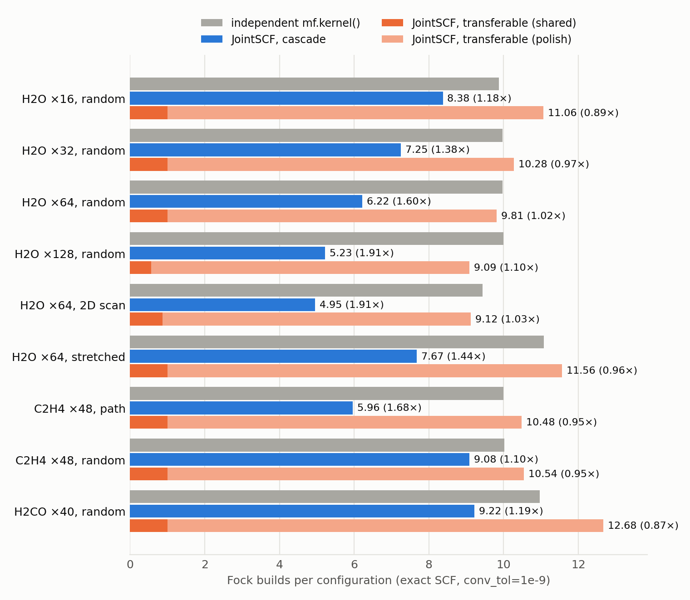

# JointSCF：多构型单循环同步 SCF——方案审查、算法设计与基准对比

本报告对应分支 `claude/nifty-hypatia-82wvns` 上的实现：

| 文件 | 内容 |
|---|---|
| `pyscf/scf/jointscf.py`（新增） | `JointSCF` 驱动、跨构型共享模型 `SharedModel`、线程/进程后端 |
| `pyscf/dft/numint.py`（修改） | 新增 `CachedNumInt`：在内存中缓存格点 AO 值 |
| `pyscf/scf/__init__.py`（修改） | 导出 `scf.JointSCF`、`scf.jointscf` |
| `pyscf/scf/test/test_jointscf.py`、`pyscf/dft/test/test_cached_numint.py`（新增） | 19 个单元测试 |
| `examples/scf/57-joint_scf.py`（新增） | 用法示例 |
| `benchmark/jointscf/` （新增） | 构型系综、基准驱动、原始数据 `results.json`、本报告 |

## 结论摘要

* **单点精度**：两种调度下 9 个系综、480 个构型全部收敛，相对 1e-12 收敛参考能量的最大偏差 ≤ 1.1e-9 Ha，与直接计算同量级（表 1）。
* **严格同步（`sync`）**：Fock 次数与直接计算逐一相同，4 核下时间为"4 进程独立计算"的 0.90–1.00 倍（略慢，来自驱动开销）。这验证了 §1.2 的分析：严格同步下跨构型共享不减少 Fock 次数。
* **级联（`cascade`）**：Fock/构型降为直接计算的 1/1.10 – 1/1.91；收益随批次密度增加（H2O：16→128 构型，1.18×→1.91×），在扫描/路径类数据上最大（1.68–1.90×）。
* **墙钟时间，单核**：1.08–1.82× 快于直接计算；加上 `CachedNumInt` 后相对直接计算 1.0–2.2×。
* **墙钟时间，4 核，同核数公平对比（对 4 个独立单线程进程）**：低维/密集批次 1.18–1.53×（H2O ×16 为 1.00×）；稀疏的高维随机批次（C2H4 随机、H2CO）为 0.89–0.91×，即**变慢约 10%**——Fock 节省（9–16%）不足以抵消级联早期只有少数构型在算造成的核空闲。
* **PySCF 默认 4 线程跑小分子**比 1 线程还慢 2.8–3.0×（OpenMP 过度订阅），原报告"13–18 倍"的基线即此；本报告所有加速比都以合理基线计算。
* **代价**：`CachedNumInt` 内存显著增加（H2O ×128 单进程 3.6 GB）；H2CO/def2-TZVP 上单核时缓存反而变慢（0.72×，内存带宽受限），大基组时不建议开启。


---

## 1. 对原方案（shared_lowrank_joint_scf）的审查

### 1.1 原报告的结论与它自带数据的对照

下表的数字全部取自压缩包内的 `simultaneous_joint_results.json`，没有重新计算。

| 体系 | 单点基准 Fock/构型 | 同步联合 r_Δ=0 Fock/构型 | r_Δ=0 平均 / 最大能量误差 | 同步联合"精确"(r_Δ=None) Fock/构型 | 8 核：联合 r_Δ=0 相对 8 核独立并行 |
|---|---:|---:|---:|---:|---:|
| H2O ×16 | 10.00 | 8.88 | 0.57 / 0.99 mHa | 10.00 | 0.91× |
| H2O ×64 | 10.00 | 8.88 | 0.29 / 0.45 mHa | 10.00 | 1.05× |
| H2O ×128 | 9.99 | 8.91 | 0.16 / 0.37 mHa | 9.99 | 1.08× |
| 拉伸 H2O ×64 | 11.02 | 9.53 | 11.7 / **285.6** mHa | 11.02 | 1.00× |
| C2H4 ×48 | 10.00 | 9.40 | 7.9 / **98.0** mHa | 10.94 | 0.96× |
| H2CO ×40 (B3LYP) | 11.05 | 9.05 | 3.4 / 5.9 mHa | 11.03 | 1.11× |

从这些数据可以直接读出三点：

1. **"10%–18% 的 Fock 次数缩减"不是同精度比较。** r_Δ=0 模式的收敛阈值是
   `conv_tol_energy=1e-8, conv_tol_comm=5e-5`（且对易子只在 K 维子空间内度量），基准用的是
   `1e-9, 1e-6`；同时 r_Δ=0 的解被限制在共享低秩流形上，是变分上界而不是单点解，
   平均误差 0.2–12 mHa，个别构型达到 98 和 286 mHa。少算的那一次 Fock 来自放宽的判据和被截断的变分空间。
2. **一旦要求精确解（r_Δ=None），Fock 次数与独立计算完全相同**（10.00 对 10.00，11.02 对 11.02，
   乙烯反而从 10.00 增到 10.94）。此时共享子空间不起任何作用，1.03–1.14 倍的单核提速来自拼接格点批量调用 LibXC 等工程因素。
3. **同核数对比下没有优势**：8 进程同步联合相对 8 进程独立并行为 0.78–1.11 倍。
   "13–18 倍"是相对 `原生 PySCF 8 线程` 的，而这个基准本身比 1 线程还慢（M=16 时 22.2 s 对 8.0 s），
   是小分子上 OpenMP 过度订阅造成的，不能代表"直接计算"的合理水平（本报告 §4 复现了这一现象）。

### 1.2 根因：严格同步时，批次内的信息是对称的

"所有波函数从初猜起、每步每构型恰好一次 Fock"意味着所有构型在每一步处于**同一收敛阶段**。
对同一个确定性算法、同一个初猜，第 t 步的迭代量 F_c^(t) 本身就是几何的光滑函数——
这正是它可以被低秩表示的原因，但也意味着**任何一个构型都不掌握其他构型需要而没有的信息**。
跨构型耦合能加速的前提是信息不对称（有的构型走在前面）。在严格同步下唯一可共享的是
SCF 映射的 Jacobian，而我们的估算和实验都表明它的价值很小：

* 对这类体系，DIIS 从第 3 步起每步约降一个量级；即使有精确 Jacobian（牛顿法），也只能把 9–10 次 Fock
  降到约 7 次，上限约 20–30%。
* 不同构型的割线对 (ΔD, ΔF) 方向几乎平行，差异与 Jacobian 随几何的变化同阶，信噪比约为 1，
  汇总到一起并不能得到比各自 DIIS 更好的外推。

另外两点也限制了原方案：

* **低秩约束不降低 Fock 的成本。** 对这些小分子（N_AO ≤ 74），一次迭代的时间几乎全部在 J/K 和 XC 积分上，
  K×K 对角化替代 N×N 对角化节省的时间可以忽略；而 Fock 构造对密度矩阵是否低秩没有任何利用。
* **SCF 的迭代次数对初猜/约束的质量并不敏感**（本工作 §2.3 的实测）：密度误差每降低一个量级只省约 1 次 Fock。

### 1.3 代码层面的问题

| 问题 | 位置 | 处理 |
|---|---|---|
| 三份几乎相同的 Fock 构造代码（`evaluate_ks`、`eval_ks_concatenated_configs`、`eval_ks_dm_concatenated_configs`），只支持闭壳层、LDA/GGA、无范围分离、N_AO ≤ 120、格点 ≤ 25 万 | `joint_ks_scf.py`, `_mp_ks_worker.py` | 不再自写 Fock：驱动直接调用每个 `mf` 自己的 `get_veff/get_fock/eig/get_occ`，因此 RHF/UHF/ROHF/RKS/UKS、杂化、meta-GGA、密度拟合等都自动支持 |
| 自写的单点求解器与 PySCF 的收敛判据、DIIS 细节不同，结果不能与 `mf.kernel()` 逐项对应 | `solve_single_point_fast_ks` | 循环体与 `scf.hf.kernel` 逐行一致，收敛判据、extra cycle、chkfile、回调钩子都相同 |
| 轨道表示需要规范固定（QR 相位、Procrustes 对齐、等占据块旋转），是非光滑性和实现复杂度的主要来源 | `lowrank_orbitals.py`, `batched_qf` | 共享模型改为作用在**密度矩阵和 Fock 矩阵**上，它们与轨道规范无关 |
| 共享映射是固定随机种子的 tanh 随机特征 + 岭回归，超参数（隐藏单元数、`ridge_reg`、`subspace_lock_tol`、`max_subspace_rot_iter` …）靠手调 | `SimultaneousJointKSSCF` | 核岭回归，长度尺度与岭参数由留一交叉验证自动选择；提升时机由模型的留一误差自动决定 |
| 需要用户提供几何描述符；矩阵在实验室坐标系中比较，分子整体转动会破坏光滑性 | `GeometryConditionedProvider` | 默认描述符为原子间距倒数；比较前用 Kabsch 转动把各构型对齐（AO 旋转矩阵），整体平动/转动不影响结果 |
| 所有构型必须同形状（`n_ao, rank, n_orbitals` 一致） | `SimultaneousJointKSSCF.__init__` | 批次自动按（方法、泛函、元素序列、基组）分组；不成组的构型按同步模式处理 |
| 进程池依赖 `spawn` 重新导入用户主模块、临时改写 `PYTHONPATH`/线程环境变量、模块级全局状态 `_WORKER_CONFIGS` | `batched_ks_scf.py`, `_mp_ks_worker.py` | 工作进程用独立解释器启动，不导入用户脚本；状态由进程自己持有；对象不可序列化时自动退回线程后端 |
| AO 格点值缓存写死在专用类里 | `MolecularKSConfig` | 提炼为通用的 `dft.numint.CachedNumInt`，对所有 `nr_rks/nr_uks/get_rho/fxc` 透明，结果与 `NumInt` 相同 |

---

## 2. 优化后的方案

### 2.1 保留了什么，改变了什么

| | 原方案 | 本实现 |
|---|---|---|
| 目标 | 全批波函数从初猜起在同一单循环中求解 | 相同 |
| 结果 | r_Δ=0/1 为低秩近似解；r_Δ=None 才是单点解 | **始终是单点解**：每个构型都通过 `scf.hf.kernel` 的收敛判据 |
| 共享低秩结构的角色 | 对波函数的**约束** | 跨构型传递信息的**预测器**（不约束最终解） |
| 共享的对象 | 轨道 U_c = qf(Φ_θ(d_c) A_c + Δ_c) | 对齐 Löwdin 基下的密度矩阵 P̃ 和 Fock 矩阵 F̃（规范无关） |
| 每步的 Fock 构造 | 每个活跃构型一次 | `sync`：每个构型一次；`cascade`：早期只有一部分构型做精确 Fock，其余由共享模型给出 |
| 批次规模效应 | Fock/构型与 M 无关 | Fock/构型随批次密度下降（§4） |

### 2.2 算法

**表示。** 对同一分子的一组构型，把 AO 矩阵变换到

    P̃_c = Rᵀ S^{1/2} D S^{1/2} R ,     F̃_c = Rᵀ S^{-1/2} F S^{-1/2} R

其中 S^{±1/2} 是对称（Löwdin）正交化，R 是把构型刚性转动到参考取向的 AO 旋转矩阵（Kabsch 对齐）。
P̃、F̃ 不依赖轨道规范，不随分子整体平动/转动变化，是内坐标的光滑函数，并且对所有构型有相同的维度和含义。
这就是"共享低秩结构"：整批的 P̃_c、F̃_c 落在一个低维流形上，可以由少数构型的值线性表出。

**共享模型。** 未知构型的矩阵由已精确计算的构型线性组合给出，X̃(z) = Σ_j w_j(z) X̃_j。权重来自以
几何描述符 z 为自变量的核岭回归（常数 + 线性 + 高斯核）。长度尺度和岭参数在每次使用前由留一交叉验证
（闭式解）选定；同一套留一残差还给出**模型误差 ε 的估计**，并且与 SCF 残差用同一个量——对易子范数 ‖[F̃, P̃]‖——度量。

**级联（cascade）调度。** 单一循环，循环变量是 SCF 迭代：

1. 按描述符空间的最远点采样给整批构型排序，前 n₀ 个为领跑层，其后每层使精确构型数翻倍。
2. 第 0 轮：领跑层从初猜出发做精确 Fock。其余构型此时没有自己的 Fock 构造，它们在每一步的状态
   (P̃, F̃) 由共享模型从领跑层给出（实现上惰性求值，只在提升时计算）。
3. 每个 SCF 迭代：所有已提升且未收敛的构型各做一次标准的 SCF 迭代（DIIS → 对角化 → 精确 Fock）。
4. **提升判据**：当已精确构型的最大残差 ≤ 模型留一误差 ε 时，下一层被提升——此时继续等待已不能改善预测。
5. **锚定与 DIIS 历史继承**：被提升构型的第一次精确 Fock 构造在模型预测的密度上进行（锚点）。
   精确值与预测值之差是模型在该点的误差，用它整体平移继承来的历史 Fock 矩阵后装入 DIIS 子空间。
   历史取自**领跑层的迭代增量**：领跑层从同一初猜出发、执行完全相同的迭代，其历史是几何的光滑函数，
   可以准确插值；只取领跑层的移动幅度大于 ε 的那些迭代。这样被提升的构型直接接续领跑层的收敛动量，
   而不是从头重建 DIIS 子空间。
6. **饱和判据**：若一半源构型与全部源构型给出的模型误差相差不到 1.5 倍（学习曲线变平），
   说明增加精确构型不再改善预测，其余构型一次全部提升，避免空等。
7. 每个构型此后独立地按 `scf.hf.kernel` 的判据收敛（含 extra cycle），收敛后退出活跃集。

**同步（sync）调度**是 n₀ = M 的特例：每个构型每轮一次精确 Fock，算术上与独立的 `mf.kernel()` 相同。

### 2.3 为什么需要"继承 DIIS 历史"

消融实验（`benchmark/jointscf/count_fock.py <case> diis_inherit=0`）：同一级联调度，被提升构型只用模型预测的密度作锚点，DIIS 从头开始。

| 系综 | 直接计算 | 级联，不继承 DIIS 历史 | 级联，继承领跑层历史（默认） |
|---|---:|---:|---:|
| H2O ×64 随机 | 9.97 | 6.89（1.45×） | 6.22（1.60×） |
| H2O ×64 二维扫描 | 9.44 | 5.70（1.65×） | 4.97（1.90×） |
| C2H4 ×48 路径 | 10.00 | 6.65（1.50×） | 5.96（1.68×） |

（数值为每构型 Fock 次数，括号内为相对直接计算的比值。）继承历史使总 Fock 次数再减少约 10–13%：被提升层每构型少 0.6–1.7 次，而且由于被提升构型收敛更快，下一层的提升也提前 1–3 个迭代（例如二维扫描最后一层从第 12 步提前到第 9 步）。
原因是 DIIS 的"热身"代价：从误差约 1e-3 的初猜重新开始，前 2–3 次迭代收缩很慢，之后 DIIS 子空间才足够大。继承领跑层的历史消除了这段热身。

### 2.4 实现结构

* **驱动复用 PySCF 自身的 SCF 步骤。** 每个构型的一次迭代就是 `scf.hf.kernel` 的循环体
  （`get_fock`+DIIS → `eig` → `get_occ` → `make_rdm1` → `get_veff` → `energy_tot` → 收敛判断 → extra cycle），
  全部通过 `mf` 对象自己的方法调用。因此 `sync` 调度在算术上与独立的 `mf.kernel()` 相同，
  任何定制了这些方法的平均场类都自动适用。
* **后端。** `parallel='process'`（默认）：每个工作进程持有一部分构型的全部状态（积分、格点、DIIS），
  驱动进程只收发每次迭代的摘要（能量、梯度范数，以及级联成员的 P、F 矩阵）。各工作进程独立推进自己持有的构型，
  不在"轮"的末尾互相等待；构型在收到第一个任务时分配给当前负载最小的进程。
  工作进程用独立解释器启动，不导入用户脚本。对象不可序列化（例如 `density_fit()` 生成的动态类）
  或使用回调函数时自动退回 `parallel='thread'`。
* **确定性。** 提升判据只依赖"所有已精确构型都已完成的 SCF 迭代编号 it"以及它们在该迭代上的状态，
  与各工作进程返回结果的先后无关，所以线程后端、进程后端、任意工作进程数给出相同的迭代序列和 Fock 次数
  （单元测试 `test_parallel_backends` 检验这一点）。
* **`CachedNumInt`** 只重载 `NumInt.block_loop`：第一次调用时保存 `eval_ao` 的输出块，之后直接返回。
  所有积分函数拿到的数组与 `NumInt` 完全相同，结果一致；格点被 `prune_by_density_` 替换或几何改变时缓存自动失效；
  超过 `max_cache_memory` 的块仍然即时计算。

### 2.5 与目标的对应关系

> 目标：单点求解、全批波函数从初猜起在同一个单循环 SCF 中同步优化

* **单点求解**：两种调度下每个构型的最终结果都是通过 PySCF 标准收敛判据的 SCF 解，
  与独立计算的能量差在收敛阈值量级（§4 表 1 给出相对于 1e-12 收敛参考值的实测误差）。
* **同一个单循环**：只有一个循环；没有任何构型被预先单独解到收敛。
* **从初猜起同步**：`sync` 调度逐字满足。`cascade` 调度中，领跑层从初猜出发；其余构型在被提升之前
  没有自己的精确 Fock 构造，其状态由共享模型随领跑层演化——这是为了制造信息不对称所做的、
  也是唯一的放松。需要逐字严格的同步时，设 `jmf.schedule = 'sync'`。

### 2.6 用法

```python
from pyscf import gto, dft, scf

mols = [gto.M(atom=..., basis='def2-svp') for ... in geometries]
mf = dft.RKS(mols[0], xc='pbe')
mf._numint = dft.numint.CachedNumInt()   # 可选：缓存格点 AO 值
jmf = scf.JointSCF(mf, mols)             # 或 scf.JointSCF([mf_1, mf_2, ...])
e_tot = jmf.kernel()                     # ndarray, 每个构型的总能量

jmf.converged, jmf.nfock, jmf.levels     # 收敛标志 / 精确 Fock 次数 / 所在层
jmf.mfs[i].mo_coeff                      # 每个 mf 带有与 mf.kernel() 之后相同的结果
```

主要选项：`schedule`（`'cascade'` 默认 / `'sync'`）、`max_workers`、`parallel`（`'process'` / `'thread'`）、
`descriptors`、`n_lead`、`level_growth`、`promote_ratio`。

---

## 3. 基准方法学

* **对比对象**（全部使用相同的泛函、基组、格点、初猜 `minao`、DIIS 和 PySCF 默认收敛阈值
  `conv_tol = 1e-9`、梯度 `3.2e-5`）：
  * `direct`：逐个构型调用 `dft.RKS(mol).kernel()`，即"直接计算"。分别在 1 线程、N 线程（PySCF 默认行为）
    和 N 个单线程进程（实际工作中最合理的并行方式）下测量。
  * `JointSCF sync` / `JointSCF cascade`：1 个工作进程（单核）和 N 个工作进程。
  * 以上各项再加 `CachedNumInt`（`+ AO cache`），用于把"内核加速"与"算法收益"分开。
* **隔离**：每次测量在全新的 Python 子进程中进行，线程数由环境变量固定
  （1 核方法同时限制 numpy/scipy 自带的 BLAS 线程）。
* **计时范围**：从 `Mole` 对象到全部构型收敛，包含格点生成、积分和全部 SCF 迭代；不含导入 PySCF 和构造 `Mole`。
  工作进程的启动时间（独立进程池与 JointSCF 的工作进程）单独记录（表 4），不计入求解时间。
* **重复**：每个时间测 3 次，报告中位数和范围；`direct (N 线程)` 与 `sync (1 核)` 各测 1 次。
* **与硬件无关的指标**：精确 Fock 构造次数（`get_veff` 调用次数；`direct` 通过包装 `get_veff` 计数，
  为 初猜 1 次 + 迭代次数 + extra cycle 1 次）。
* **精度**：另做一组收敛到 `1e-12` 的独立计算作为参考能量 E_ref，报告各方法相对 E_ref 的最大偏差。
* **系综**：四个随机系综沿用原基准脚本的分布和随机种子（H2O、拉伸 H2O、C2H4、H2CO）；
  另加两个结构化系综（H2O 二维扫描、C2H4 沿一条光滑闭合路径），代表势能面扫描/轨迹类数据。

## 4. 结果




### Environment

| | |
|---|---|
| cpu | Intel(R) Xeon(R) Processor @ 2.10GHz |
| ncpu | 4 |
| mem_gb | 15.7 |
| platform | Linux-6.18.44-fc-v470-x86_64-with-glibc2.39 |
| python | 3.13.18 |
| numpy | 2.5.3 |
| scipy | 1.18.1 |
| pyscf | 2.14.0 |
| git | 30f225486771561b7e4512516c06e3e7b965ac24 |

### Table 1. Fock builds per configuration and accuracy

All methods use the same convergence criteria (conv_tol = 1e-9 Ha, gradient 3.2e-5).  E_ref: independent calculations converged to 1e-12 Ha.

| ensemble | level of theory | N_AO | direct | JointSCF sync | JointSCF cascade | direct / cascade | converged | max\|E_direct − E_ref\| | max\|E_cascade − E_ref\| |
|---|---|---:|---:|---:|---:|---:|---:|---:|---:|
| H2O ×16, random | PBE/def2-SVP | 24 | 9.88 | 9.88 | 8.38 | 1.18× | 16/16 | 2.6e-11 | 2.6e-11 |
| H2O ×32, random | PBE/def2-SVP | 24 | 9.97 | 9.97 | 7.25 | 1.38× | 32/32 | 2.6e-11 | 1.5e-11 |
| H2O ×64, random | PBE/def2-SVP | 24 | 9.97 | 9.97 | 6.22 | 1.60× | 64/64 | 2.6e-11 | 1.1e-10 |
| H2O ×128, random | PBE/def2-SVP | 24 | 9.99 | 9.99 | 5.23 | 1.91× | 128/128 | 2.6e-11 | 1.3e-10 |
| H2O ×64, 2D scan | PBE/def2-SVP | 24 | 9.44 | 9.44 | 4.97 | 1.90× | 64/64 | 1.1e-11 | 7.7e-11 |
| H2O ×64, stretched | PBE/def2-SVP | 24 | 11.08 | 11.08 | 7.67 | 1.44× | 64/64 | 8.5e-10 | 1.1e-09 |
| C2H4 ×48, path | PBE/def2-SVP | 48 | 10.00 | 10.00 | 5.96 | 1.68× | 48/48 | 1.0e-10 | 1.0e-10 |
| C2H4 ×48, random | PBE/def2-SVP | 48 | 10.02 | 10.02 | 9.08 | 1.10× | 48/48 | 1.2e-10 | 3.9e-10 |
| H2CO ×40, random | B3LYP/def2-TZVP | 74 | 10.97 | 10.97 | 9.22 | 1.19× | 40/40 | 4.4e-10 | 3.9e-11 |

### Table 2. Wall time on one core (seconds; median and range of the repeats)

| ensemble | direct | JointSCF sync | JointSCF cascade | speed-up | direct + AO cache | cascade + AO cache | speed-up (both with cache) | cascade + cache vs direct |
|---|---:|---:|---:|---:|---:|---:|---:|---:|
| H2O ×16, random | 6.44 (6.41–6.51) | 6.36 | 5.44 (5.38–5.61) | 1.18× | 4.85 (4.57–4.99) | 4.29 (4.28–4.44) | 1.13× | 1.50× |
| H2O ×32, random | 13.02 (12.57–13.08) | 12.63 | 8.96 (8.75–9.69) | 1.45× | 9.66 (9.66–9.91) | 7.52 (7.45–7.56) | 1.28× | 1.73× |
| H2O ×64, random | 26.45 (26.21–26.72) | 26.65 | 17.00 (16.85–17.19) | 1.56× | 19.85 (19.56–19.89) | 13.85 (13.46–14.12) | 1.43× | 1.91× |
| H2O ×128, random | 51.47 (49.81–52.05) | 53.28 | 28.36 (28.23–28.59) | 1.82× | 38.68 (37.93–39.62) | 23.94 (23.60–24.59) | 1.62× | 2.15× |
| H2O ×64, 2D scan | 24.93 (24.29–25.70) | 24.44 | 14.14 (13.75–14.17) | 1.76× | 18.89 (18.77–18.96) | 11.50 (11.47–12.07) | 1.64× | 2.17× |
| H2O ×64, stretched | 28.71 (28.56–29.14) | 28.38 | 20.11 (19.94–20.70) | 1.43× | 21.20 (21.17–21.83) | 15.92 (15.83–16.76) | 1.33× | 1.80× |
| C2H4 ×48, path | 47.58 (47.25–49.43) | 44.91 | 29.04 (28.92–30.38) | 1.64× | 32.42 (31.43–32.89) | 22.76 (21.39–23.04) | 1.42× | 2.09× |
| C2H4 ×48, random | 47.87 (46.70–49.58) | 47.36 | 44.46 (42.18–44.55) | 1.08× | 33.99 (32.93–34.51) | 31.41 (30.69–31.46) | 1.08× | 1.52× |
| H2CO ×40, random | 58.05 (57.96–60.42) | 63.33 | 52.05 (51.33–52.20) | 1.12× | 41.83 (41.36–42.42) | 57.82 (56.42–57.94) | 0.72× | 1.00× |

### Table 3. Wall time on 4 cores (seconds; median and range of the repeats)

direct (4 threads): one calculation at a time with 4 OpenMP threads (the default behaviour of PySCF).  direct (4 processes): 4 independent single-thread calculations at a time.  The start-up of the worker processes is not included (Table 4).

| ensemble | direct (4 threads) | direct (4 processes) | JointSCF sync | JointSCF cascade | speed-up vs 4 processes | direct (4 proc.) + cache | cascade + cache | speed-up (both with cache) | cascade + cache vs direct 1 core |
|---|---:|---:|---:|---:|---:|---:|---:|---:|---:|
| H2O ×16, random | 18.03 | 1.63 (1.63–1.67) | 1.82 (1.80–1.83) | 1.64 (1.57–1.65) | 1.00× | 1.30 (1.28–1.35) | 1.29 (1.26–1.40) | 1.00× | 5.0× |
| H2O ×32, random | 38.37 | 3.23 (3.17–3.26) | 3.33 (3.33–3.43) | 2.73 (2.67–2.74) | 1.18× | 2.48 (2.47–2.55) | 2.32 (2.17–2.36) | 1.07× | 5.6× |
| H2O ×64, random | 79.54 | 6.78 (6.60–6.83) | 6.85 (6.73–6.92) | 5.21 (5.06–5.39) | 1.30× | 5.07 (5.03–5.20) | 4.37 (3.94–4.42) | 1.16× | 6.1× |
| H2O ×128, random | 157.27 | 12.99 (12.83–13.85) | 13.22 (13.20–13.23) | 9.02 (8.80–9.53) | 1.44× | 9.74 (9.62–10.18) | 8.34 (7.88–8.36) | 1.17× | 6.2× |
| H2O ×64, 2D scan | 72.56 | 6.44 (6.44–6.55) | 6.53 (6.53–6.58) | 4.21 (3.96–4.33) | 1.53× | 4.90 (4.88–4.98) | 3.65 (3.40–3.94) | 1.34× | 6.8× |
| H2O ×64, stretched | 79.12 | 7.23 (7.15–7.47) | 7.40 (7.31–7.48) | 5.82 (5.65–5.98) | 1.24× | 5.56 (5.46–5.61) | 4.68 (4.63–4.94) | 1.19× | 6.1× |
| C2H4 ×48, path | 62.73 | 11.86 (11.58–12.48) | 11.86 (11.80–12.29) | 9.57 (9.48–9.72) | 1.24× | 8.52 (8.19–8.57) | 7.03 (6.85–7.89) | 1.21× | 6.8× |
| C2H4 ×48, random | 63.61 | 12.52 (12.14–12.97) | 12.81 (12.50–13.16) | 13.76 (13.03–14.49) | 0.91× | 8.69 (8.33–8.83) | 9.45 (9.10–9.94) | 0.92× | 5.1× |
| H2CO ×40, random | 74.91 | 15.05 (14.87–16.22) | 15.47 (15.22–16.33) | 16.93 (16.21–17.34) | 0.89× | 10.90 (10.83–11.00) | 12.70 (12.07–12.79) | 0.86× | 4.6× |

### Table 4. Start-up of the worker processes and peak memory

| ensemble | start-up direct (4 proc.) / s | start-up JointSCF (4 workers) / s | peak RSS direct 1 core / MB | peak RSS cascade 1 worker / MB | peak RSS cascade 1 worker + cache / MB |
|---|---:|---:|---:|---:|---:|
| H2O ×16, random | 0.52 | 0.39 | 154 | 173 | 580 |
| H2O ×32, random | 0.50 | 0.40 | 165 | 203 | 999 |
| H2O ×64, random | 0.52 | 0.44 | 168 | 265 | 1847 |
| H2O ×128, random | 0.50 | 0.48 | 174 | 394 | 3553 |
| H2O ×64, 2D scan | 0.51 | 0.44 | 167 | 267 | 1847 |
| H2O ×64, stretched | 0.52 | 0.45 | 170 | 266 | 1847 |
| C2H4 ×48, path | 0.55 | 0.43 | 295 | 568 | 3650 |
| C2H4 ×48, random | 0.53 | 0.46 | 297 | 574 | 3645 |
| H2CO ×40, random | 0.55 | 0.51 | 643 | 1515 | 4197 |

### Table 5. Cascade schedule

Levels: number of configurations / SCF cycle of the promotion / mean number of Fock builds.  Model error: leave-one-out error of the cross-configuration model at the promotions (norm of the commutator [F, D]).

| ensemble | descriptors | levels (size / cycle / Fock builds) | model error at the promotions |
|---|---:|---|---|
| H2O ×16, random | 3 | 8 / 0 / 9.75, 8 / 4 / 7.00 | 5.0e-02 (8 src) |
| H2O ×32, random | 3 | 8 / 0 / 10.00, 8 / 4 / 7.12, 16 / 6 / 5.94 | 5.0e-02 (8 src), 1.0e-02 (16 src) |
| H2O ×64, random | 3 | 8 / 0 / 10.12, 8 / 4 / 7.25, 16 / 6 / 6.06, 32 / 8 / 5.06 | 8.8e-02 (8 src), 1.7e-02 (16 src), 1.4e-03 (32 src) |
| H2O ×128, random | 3 | 8 / 0 / 10.00, 8 / 4 / 7.25, 16 / 6 / 6.00, 32 / 8 / 5.12, 64 / 10 / 4.25 | 1.3e-01 (8 src), 1.6e-02 (16 src), 2.1e-03 (32 src), 2.3e-04 (64 src) |
| H2O ×64, 2D scan | 2 | 8 / 0 / 9.50, 8 / 5 / 5.62, 16 / 7 / 4.25, 32 / 9 / 4.03 | 1.2e-02 (8 src), 5.7e-04 (16 src), 2.9e-05 (32 src) |
| H2O ×64, stretched | 3 | 8 / 0 / 11.00, 8 / 4 / 8.12, 16 / 6 / 7.69, 32 / 9 / 6.72 | 3.6e-01 (8 src), 1.1e-01 (16 src), 2.2e-02 (32 src) |
| C2H4 ×48, path | 10 | 12 / 0 / 10.00, 12 / 5 / 5.83, 24 / 8 / 4.00 | 1.0e-02 (12 src), 1.4e-04 (24 src) |
| C2H4 ×48, random | 11 | 13 / 0 / 10.00, 13 / 4 / 9.08, 22 / 8 / 8.55 | 1.5e-01 (13 src), 5.3e-02 (26 src) |
| H2CO ×40, random | 6 | 8 / 0 / 11.00, 8 / 3 / 9.00, 16 / 5 / 8.69, 8 / 8 / 8.75 | 1.3e-01 (8 src), 5.9e-02 (16 src), 3.0e-02 (32 src) |


### 讨论

1. **收益的来源是信息不对称，而不是同步本身。** `sync` 与直接计算的 Fock 次数完全相同（表 1），级联的全部收益来自被提升构型（表 5：后几层 4.0–6.1 次，领跑层 9.5–11 次）。
2. **收益由模型精度决定。** 提升时的留一误差越小，被提升层需要的 Fock 越少：二维扫描在第 9 步误差 2.9e-5，最后一层 4.03 次（协议下限 4）；C2H4 随机系综 11 个描述符只有 48 个样本，误差停在 5e-2，后续层仍需 8.6–9.1 次。
3. **并行效率是 4 核下的主要瓶颈。** 级联前几步只有 8–13 个构型活跃，4 个工作进程有时不满载；Fock 节省小时这会抵消收益（C2H4 随机、H2CO）。可行的改进：领跑层大小取工作进程数的整数倍、在等待期间预先计算被提升构型的积分/格点。
4. **适用范围**：同一分子、同一方法的一批几何（势能面扫描、MD/采样轨迹、主动学习候选），批次越大越密越好。不适用：少量构型（< 6 个时自动退回 `sync`）、互不相同的分子、高维稀疏采样。

